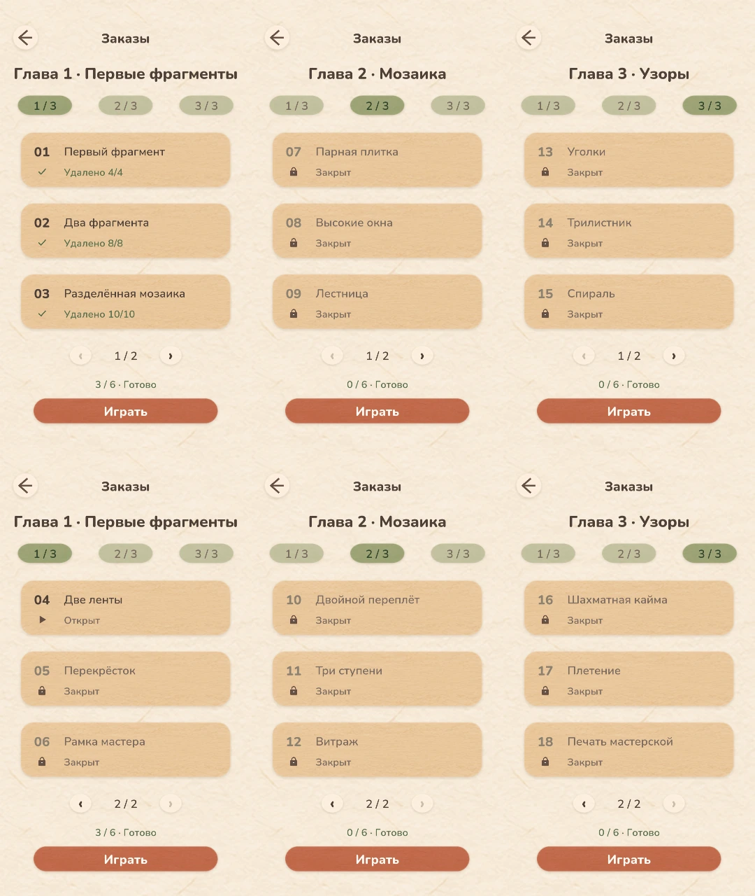
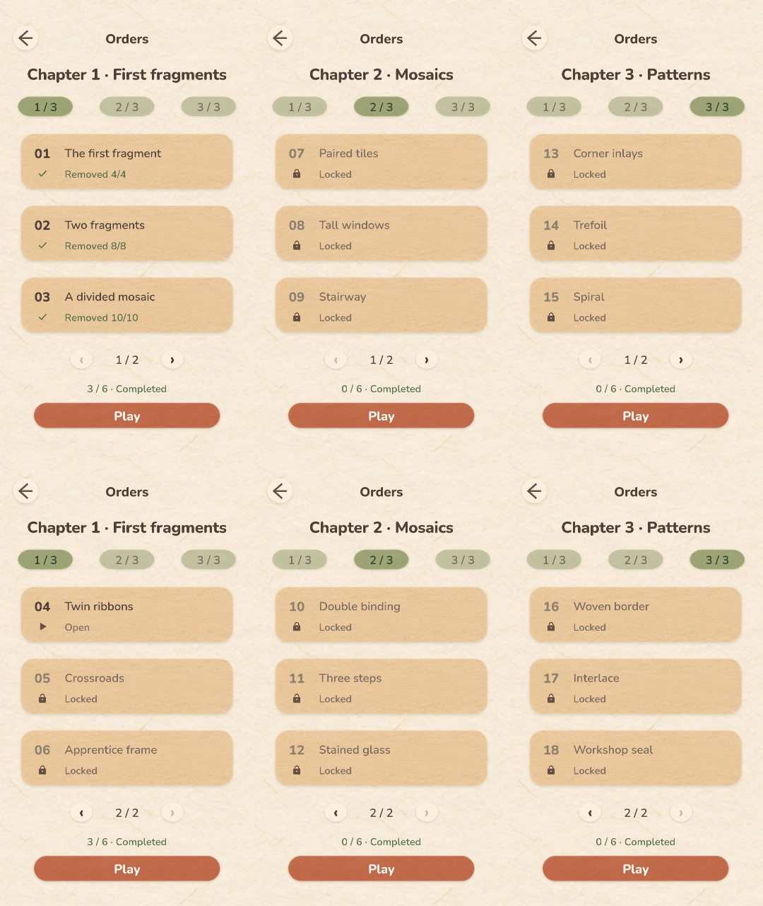
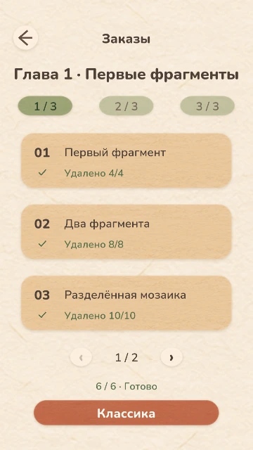
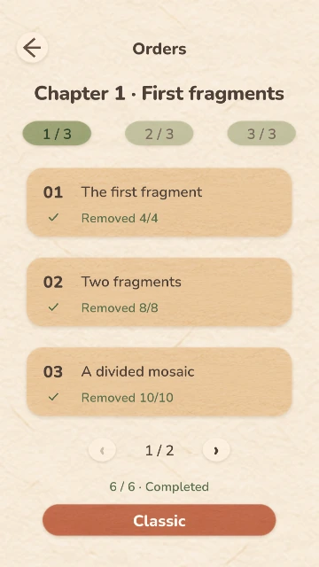

# Campaign journal and random trays — QA

Date: 2026-11-16. Base: `dev` at `573989f6a981e9e6b01cbd08605f0fb3e13196d9`.
Draft PR: https://github.com/whil3true/block_workshop/pull/17

## Delivered behavior

- Chapter capsules and their hit areas are 120 × 50, centered at x = 86 / 240 / 394. Labels share those centers.
- One column of 416 × 120 order cards, three per page, two pages per chapter. A changed chapter opens page 1. Starting an order remembers its chapter/page for exit, victory, defeat and replay return paths.
- Every card uses the same two-line stack: full title and compact status. Completed cards show a check and `Removed N/N` / `Удалено N/N`; there is no extra Completed/Готово row. Locked cards remain visible and noninteractive.
- Orders 01–03 retain original fixed deals, layouts, fallback seed, constructive solutions and recovery paths.
- Orders 04–18 have `deal: 'random'` and no runtime `trays` or authored seed. Entropy is sampled once per entry/retry with `crypto.getRandomValues`; xorshift state continues deterministically inside that attempt. Explicit nonzero uint32 seed injection is available to model tests, with no production URL seed override or debug bridge.
- Every random deal uses the existing Classic `sampleTray` family weights and its small-family bias. It receives no board/target input, does not choose shapes to fill gaps, and performs no rescue rerolls. Identical combinations can occur by chance.
- Victory takes priority over refill; an unplayable tray results in the existing defeat screen. Free retry starts a new attempt. The generator has no retry loop.
- Stable order IDs, starting boards, targets, unlocking and achievements-only v2 storage are unchanged. Completed 01–18 remain completed after failed replays. Unfinished attempts remain memory-only. Classic, SDK and ads are unchanged.

## Validation

Node 22.23.5: `npm run check` passed — TypeScript, raster validation, 607 unit tests, production build, distribution validation. Build: 50 files, 4,834,786 bytes. The existing Vite large-chunk advisory remains.

New model tests exercise first random deals, independent retry entropy, reproducible seeds/refills, invalid seeds, 10,000 deals across all 37 shapes, legal failure, free retry, full 18-order save preservation, and terminal-state handling. Historical authored paths remain test-only evidence of the layouts' constructive solvability; real random victory/loss fixtures exercise production generation.

Journal tests assert capsule symmetry, hit areas, both pages in every chapter, all 18 RU/EN titles, fixed card geometry, locked cards, compact completed status, chapter reset and return-page selection. Playwright adds both-page mobile captures at 320/360/393 CSS px, title measurement at the existing 22px body font, landscape/desktop screenshots, changed rendered random openings on retry/reentry, real seeded victory for every order, and order-18 defeat followed by free retry.

Production Playwright matrix: [GitHub Actions](https://github.com/whil3true/block_workshop/actions/runs/43847410520). The PR description records the final per-browser counts and the latest successful CI run. Firefox completed with 126 passed and 2 existing Chromium-only native-touch skips; the screenshot review below uses that artifact.

## Difficulty check

Run `node scripts/analyze-campaign.mjs` to reproduce the offline balance sample. It uses an external QA player that favors target-clearing placements and nearly-filled target axes. The runtime dealer cannot inspect this analysis or its fixtures.

Across 25 seeds for each of 15 random orders (375 attempts), this heuristic won 374. Each order also has a real losing trace from deliberate crowding. Order 18's successful sample paths range from 11 to 28 moves. These are technical feasibility and variation checks, not a human win-rate estimate or proof that every seed is winnable.

The layouts remain approachable for a strong placement heuristic. No board or weight changes were justified by evidence of practical impossibility. Human Android play is still needed to judge whether the added randomness provides the desired difficulty.

## Remaining manual checks

Physical Android touch/visual QA and Yandex draft runtime QA remain outstanding. Desktop browser viewports do not replace a device test. No merge or deployment is performed by this PR.

## Screenshot review

All six chapter/page combinations in both languages were reviewed from Firefox CI at 360 CSS px. All 18 titles remain on one line, with no number/status overlap. The 320px captures retain the same layout. Original PNGs, landscape/desktop captures and result-screen captures are in the CI artifact; the following WebP review copies use quality 92.

[Reproducible balance summary](evidence/campaign-ui-random-trays/balance-summary.json).
