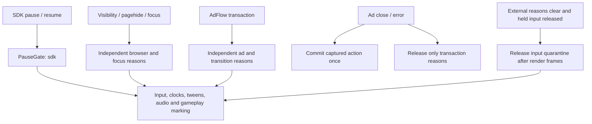

# Yandex release readiness audit

Audit date: 2026-11-17 (Europe/Moscow). Working title: Block Workshop.
Base: `dev` @ f80724be22d07756b863b8f6ef628aa067019fbb.
Cozy Gallery read-only reference: `dev` @ da4a7612c870ce75d678b939a491157ae3670883.

## Verdict

**CONDITIONAL GO.** Implementation is prepared for Yandex draft QA; publication requires the
real-advertisement and physical Android checks listed below. The current PR's mandatory CI checks
must be green before taking its production build. No real advertisement, physical Android run,
upload or moderation is claimed. Automated success is not moderation approval.

## Advertising points

All requests use the same InterstitialController and AdFlow instances, constructed once in bootstrap.

| Source / final action | Format / execution |
| --- | --- |
| Startup | Platform automatic advertisement only; no manual fullscreen request |
| Menu: modes, settings; journal entry, chapter switches, journal → menu | No request |
| Order result → next (including chapter boundaries) | Interstitial, then captured next order |
| Completed order card → replay | Interstitial, then captured completed order; opening journal/changing chapter still requests nothing |
| Order result → replay, including failed / final order | Interstitial, then fresh current order |
| Confirmed in-order restart | Interstitial, then reset current attempt |
| Order field → journal / menu | Existing warning preserved after moves; Stay requests nothing; confirmed exit requests interstitial, then abandons attempt |
| Order result → journal / menu, including order 18 | Interstitial, then destination; earned results already persisted |
| Classic field / defeat → menu | Interstitial, then menu; snapshot preserved |
| Confirmed Classic new game, including defeat | Interstitial, then commitRestart; record/settings preserved |
| Classic successful placement after 90 active seconds | Interstitial eligibility through same controller; no countdown |
| Classic refresh, including recoverable defeat | Voluntary confirmed rewarded; once per Classic session |

Opening a confirmation or declining it never requests an advertisement. First-time order selection
has no ad; selecting a completed order card is an explicit replay and uses the same transaction.
The non-gameplay 'startup' pause marker used on journal/menu does not block this explicit UI
transition; all actual SDK/browser/manual/input/ad owners continue to block it.

## Single controller and transaction ownership

- Startup cooldown: 90 seconds from controller construction, conservatively accounting for portal startup advertising.
- Successful fullscreen: next eligibility at least 90 seconds after completion.
- An advertisement that opened but later reports an error also consumes the cooldown.
- Rewarded that actually opened extends the same fullscreen cooldown at completion, even without a reward.
- Failed fullscreen/no-fill requests: at least 15 seconds between attempts.
- No SDK ad-readiness API is invented. `eligible` means local frequency eligibility only.
- AdFlow serializes both formats, rejects rapid repeated actions and captures one destination.
- onOpen activates the cover; no-fill/cooldown does not flash a cover.
- onClose(true/false), onError, exceptions and existing bounded watchdogs settle the SDK promise once.
- Chosen action commits after settlement, even if SDK pause is still held. SDK resume is never forged.
- The old board/session remains saved until the chosen new-game action commits.

## Pause, input and rendering

Pause reasons are independent; manual dialogs stop gameplay marking while preserving background
music and UI sound. External SDK/browser/focus/ad/transition/input reasons suspend audio.
Visibility and focus changes cancel drags. Scene clock/tweens stop during PauseGate pauses.
The active Classic clock is sampled using a monotonic clock, with pause boundaries synchronized
immediately. There is one clock, no setInterval and no recurring scheduled ad callback.

SdkInputGuard attaches before SDK/font loading. It captures pointer/touch/mouse/keyboard events,
tracks simultaneous holds, consumes their release/click, and admits fresh input after two render
frames once all external owners release. Disposal invalidates outstanding releases.
All ordinary UI and Splash remain inside the existing Canvas. A technical opaque DOM navigation
shield, adapted from Cozy Gallery, protects the old frame even if the renderer is suspended by the
browser. It appears only on real onOpen, is released after destination render frames, and arms its
10-second failsafe only after the ad settles and navigation commits. It has no text/buttons.
Plain window blur preserves the restored source-figure appearance while independently freezing
input, clocks and gameplay marking. SDK/browser/ad pauses still receive the normal pause cover.

## Startup

Official /sdk.js → YaGames.init; explicit standalone hosts skip SDK. SDK listeners attach before
Phaser/audio. The first Canvas presentation is opaque warm paper with only the existing raster
mosaic flower. It has no text or hit areas and introduces no cosmetic minimum loading delay.
After external pause/held-input clearance, the menu is constructed, rendered, and LoadingAPI.ready
is sent once. No GameplayAPI.start on Splash/menu/journal/result/dialog/background/ad.
Menu buttons are not constructed on startup pause frames. Startup never calls showFullscreenAdv.

## Rewarded

prepareReward captures session/revision and candidate figures before the voluntary confirmation.
Only onRewarded sets entitlement; only successful onClose settles it as usable. Error/throw/watchdog
never authorizes a tray change, including when onRewarded arrived earlier.
AdFlow stages the offer while SDK/browser/input pause is held and commits once in a safe state.
commitReward rejects stale session/revision and repeat usage. Unavailable/cancelled/error advertising
keeps the tray; standalone WebPlatform never grants a simulated reward. Existing RU/EN text and
one refresh per Classic game remain unchanged.

## 90-second choice and official policy

Checked official sources on audit date:

- [Advertising placement §4.4](https://yandex.ru/dev/games/doc/ru/requirements/4/4)
- [SDK advertising](https://yandex.ru/dev/games/doc/ru/sdk/sdk-adv)
- [SDK installation](https://yandex.ru/dev/games/doc/ru/sdk/sdk-about)
- [Loading and gameplay](https://yandex.ru/dev/games/doc/ru/sdk/sdk-game-events)
- [SDK events and startup advertising](https://yandex.ru/dev/games/doc/ru/sdk/sdk-events)
- [Full requirements](https://yandex.ru/dev/games/doc/ru/concepts/requirements)
- [Progress preservation §1.9](https://yandex.ru/dev/games/doc/ru/requirements/1/9)

**Chosen implementation: no warning/countdown.** Block Workshop fits the policy definition of
a conditional turn-based puzzle. The applicable placement section specifies an immediate request
after an action without a warning; the two-second warning belongs to long real-time gameplay.
Classification is our engineering interpretation of that documented distinction.

The 90-second threshold only enables a request at the next valid completed placement. It never
interrupts a held figure or fires while idle. The request occurs in the drop handler, before any new
cosmetic clear flash; previous cosmetic flashes are removed. No interaction-dependent animation is
interrupted and no intentional two-second delay is added.

Excluded: Splash, menu, journal, orders, dialogs, SDK/browser/focus pause, ad waiting/showing, defeat.
After a shown ad, active time starts at zero; after no-fill, 15 more active seconds and another
placement are required. Local shared cooldown must also allow a request. New Classic session resets
the clock; scene shutdown/disposal disables it. Menu re-entry does not create another clock.

No warning screenshot is applicable: displaying the requested countdown would contradict the
chosen interpretation of §4.4 for this game.

## Persistence and unchanged scope

Classic placement and reward persist immediately; exit preserves the snapshot, record and settings.
Confirmed new game calls commitRestart only after the advertising transaction settles.
Campaign success persists completed orders before any result navigation. Short unfinished attempts
are intentionally discarded on exit/reload; preserve this existing product rule and disclose it in
the developer comment in the Yandex draft. No storage schema, namespace or campaign content changed.
Manual language wins over SDK locale; SDK locale wins over existing fallback. Local persistence is
appropriate to this simple game without purchases; cloud saves are not claimed.

No engine/rules/score/37-shape/6×3 campaign/randomization/asset redesign/CI workflow changes.
The existing dev-only Pages deploy job and optimized Chromium sharding are preserved.

## Validation

Verified implementation run:
[43974954120](https://github.com/whil3true/block_workshop/actions/runs/43974954120),
runtime commit `f25c73f0235a1f37574edac459496f16cde068e0`.

| Check | Observed result |
| --- | --- |
| Node 22 npm run check | PASS; typecheck, asset inventory, unit tests, production build, dist audit |
| Unit | 631 passed, 29 files |
| Chromium | All four shards succeeded; native held-touch and actual touch placement passed |
| Firefox | 147 passed, 3 Chromium-only native-touch skips; no retries |
| WebKit | Job succeeded; 145 first-attempt passes, 2 retry recoveries, 3 Chromium-only skips |
| Pages deployment in PR | Correctly skipped; existing dev-only deployment workflow unchanged |

The two WebKit retry recoveries exposed a release/render race: fresh input could reach disabled
widgets left over from the previous paused render. The follow-up synchronously rebuilds Canvas hit
areas after quarantine/transaction release, outside input dispatch. It also adds 17 scene-level
clock tests, covering defeat, each external reason, modal/busy/menu/orders states, drag boundaries
and session/shared-ad resets. Existing assertions and CI timeout/sharding settings are unchanged.

Current-head results and artifacts are maintained at
[PR #20 checks](https://github.com/whil3true/block_workshop/pull/20/checks) and
[workflow runs](https://github.com/whil3true/block_workshop/actions?query=branch%3Afeature%2Fyandex-release-monetization-splash).
These current-head checks are authoritative for the follow-up; the table above is an identified
historical execution, not a claim that an unexecuted follow-up already passed.

The local executor was unavailable: validation ran on GitHub's Node 22 and production browser
runners. No local test/build/browser run is claimed.

Added coverage:
- Controlled-clock threshold, inactive periods, no-fill backoff, re-entry/reset/disposal.
- Input quarantine, held startup pointer, simultaneous touches, cancellation, stale release/disposal.
- Real result handlers: Next, chapter boundaries, replay, failed result, final journal/menu, Stay and confirmed exit/restart.
- SDK callback idempotency; reward error-after-grant; fullscreen/rewarded shared cooldown.
- Browser mock SDK: active-time/drop boundary, pause exclusion, no-fill retry, exit preservation,
  deferred new game, real campaign completions across chapter boundary/final result,
  reward completion/error/once-only and startup held mouse events.
- Native Chromium CDP held touch across startup advertisement, followed by actual touch placement.
- Technical navigation shield lifetime across long ads, post-navigation fallback and cleanup.
- Startup / menu / Classic screenshots for RU/EN at 320, 360 and 393 CSS px in CI artifacts.
- Existing production browser suites retain portrait/landscape/desktop, real touch (Chromium CDP),
  pagehide/pageshow, settings persistence, all campaign solutions and Pages subpath checks.

Screenshots are written into Playwright test-results and uploaded by the unchanged CI artifact step.
The verified run's [Chromium monetization/screenshots archive](https://github.com/whil3true/block_workshop/actions/runs/43974954120/artifacts/14279149782)
contains `splash-{ru,en}-{320,360,393}.png`, `menu-*.png` and `classic-*.png`.
[Firefox screenshots](https://github.com/whil3true/block_workshop/actions/runs/43974954120/artifacts/14280698316)
and [WebKit screenshots](https://github.com/whil3true/block_workshop/actions/runs/43974954120/artifacts/14280569223)
are also available. Use the current-head run's equivalent artifacts for its exact build.
These are viewport emulations, not proof of physical Android operation.

## Fixed findings

1. Campaign next/replay/result navigation previously bypassed interstitial.
2. In-order restart reset before the ad transaction; now deferred until settlement.
3. Order and Classic exits previously bypassed the controller; snapshot semantics preserved.
4. No Classic active-time intermission existed; added action-bound eligibility.
5. Startup drew menu under a loading overlay; now text-free noninteractive Splash.
6. No complete held-pointer quarantine across SDK resume; added early capture and release fencing.
7. Repeated onOpen could repeat a cover callback / extend the watchdog; now idempotent.
8. Rewarded error/watchdog could return a previously granted flag; now rejects incomplete transactions.
9. Rewarded opening did not postpone the next fullscreen; now shares the cooldown.
10. Canvas-only covering could miss a frame while browser rendering was suspended; added a technical navigation shield.
11. A blur-only pause overlay covered restored figures; preserve the original appearance with focus as an independent pause owner.
12. Fresh input could precede rebuilding enabled hit areas after release; synchronously refresh at the end of the external release transaction.
13. Completed-order journal cards also represent replay; route them through the same controller without adding ads to first-time selection or chapter navigation.

## Manual checklist in a real Yandex draft

- Upload the production archive with index.html at its root; connect monetization and confirm supported devices/orientation.
- Keep working title until the separately authorized naming/storefront task. Supply final required storefront
  materials and developer explanation of short-order attempt persistence before publication.
- Run with real ads, RU/EN, Android Chrome/Yandex Browser and desktop; also check the production/incognito path.
- Verify automatic startup ad only once; input held on ad close cannot select a mode; Splash/menu become ready quickly.
- Check each table action after cooldown, after both confirmation outcomes, across chapters and at order 18.
- Record actual button/drop → advertisement timing; no intentional delay, no accidental click.
- Check no-fill, network interruption, ad close/error and both resume/close orders; missing SDK resume must keep input/audio paused.
- Rewarded full watch / close early / error: correct once-only refresh, board/score intact, no refresh in standalone.
- Keep a long Classic game: pause/background/dialog periods excluded, next completed drop is the only timed boundary,
  no immediate repeated attempts after no-fill and no back-to-back fullscreen after rewarded/navigation.
- Switch tabs, Android apps and orientation while dragging and while ads are open; no stuck cover/audio/phantom drop.
- Reload after placement, reward, exit and each completion: Classic, record, settings, RU/EN and completed orders preserved.
- Inspect actual SDK console and GameplayAPI marks; verify mobile fullscreen/no context menu/media-session player.
- Confirm viewport screenshots on physical Android; desktop engine emulation cannot certify hardware behavior.

## Requirements checked

| Requirement | Evidence / limit |
| --- | --- |
| 1.1, 1.7, 1.19.1 | Official relative /sdk.js, bounded init; no SDK source URL baked into archive |
| 1.3, 4.7 | Independent external pause/audio gates; unit/mock-browser tests; real audio QA pending |
| 1.6, 1.8, 1.10 | Existing resize/touch/viewport suites + RU/EN 320/360/393 screens; physical Android/fullscreen pending |
| 1.9, 4.2 | Per-action local saves, completions, delayed reset; draft reload/ad-click checks pending |
| 1.19.2–4 | Rendered-menu readiness, active-only gameplay marks, independent SDK lifecycle |
| 1.14, 1.20 | Production suites in three browser engines; current-head result is linked above |
| 2.14 | Existing saved language → SDK locale → fallback precedence preserved |
| 4.1, 4.4–6 | Official formats only, action boundaries, voluntary rewarded, no custom advertisements |
| 1.11, 1.15, 5.2 | Console configuration/final storefront metadata and real-draft review are publication tasks |

## Remaining blockers

- No known outstanding implementation defect after the listed fixes. Any failed current-head mandatory CI check blocks use of that build.
- Real Yandex draft and physical Android QA remain required before publication. Draft upload and testing can proceed once current-head CI is green.
- Final approved name/storefront/media and console settings are separate publication tasks, intentionally unchanged here.
